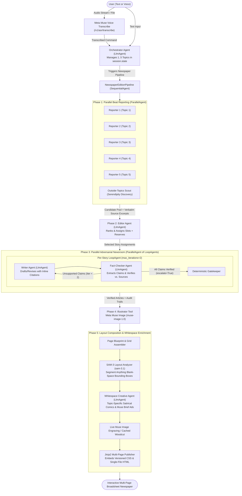

# Technical Specification & Implementation Plan: The Daily Muse (`plan.md`)
**Feature ID:** `001-daily-muse` | **Status:** Updated & Clarified (`2026-10-31`) | **Governed by:** [`.specify/memory/constitution.md`](file:///c:/Users/Karth/antigravity/Muse%20hackathon/.specify/memory/constitution.md)

---

## 1. Architectural Strategy: Hybrid Google ADK + Meta Muse Model Suite
To maximize prize competitiveness at the **Meta Global AI Developer Hackathon** while honoring the **Google Agent Development Kit (ADK)** multi-agent architecture, the system uses **Google ADK** as the deterministic orchestration harness (`SequentialAgent`, `ParallelAgent`, `LoopAgent`, `FunctionTool`, session state) and **Meta's Model Suite** (`https://api.meta.ai/v1`) as the foundational intelligence, multimodal, and vision segmentation engine:

| Component / Role | Google ADK Primitive | Meta AI Model / API Endpoint | Why This Pairing Wins |
| :--- | :--- | :--- | :--- |
| **Voice Input Desk** | Audio WebSocket / REST Hook | **Muse Voice Transcribe** (`muse-voice-transcribe-1.0` via `/v1/asr/transcribe`) | Native Meta speech-to-text for hands-free topic curation. |
| **Orchestrator Agent** | `LlmAgent` (Root) | **Muse Spark** (`muse-spark` via LiteLLM OpenAI-compatible `/v1/chat/completions`) | Parses user intent, manages `session.state["topics"]`, triggers edition builds. |
| **Beat Reporters** | `ParallelAgent` of `LlmAgent`s | **Muse Spark** + Meta `/v1/responses` **Search Grounding** | Runs up to 5 topic searches concurrently; 1M context window. |
| **Editor-in-Chief** | `LlmAgent` (Structured Output) | **Muse Spark** (High Reasoning Effort + JSON Schema) | Evaluates ~15 candidates across beats, fills slots + discovers mandatory Outside-Topics story. |
| **Writer & Fact-Checker Loops** | `ParallelAgent` of `LoopAgent(max_iterations=2)` | **Muse Spark** (Writer + Claim-Verifier with `escalate=True` on pass) | Runs story verification loops in parallel; enforces up to 2 adversarial fact-check passes per story. |
| **Illustrator Tool** | `FunctionTool` / `LlmAgent` | **Muse Image** (`muse-image-1.0` via `/v1/images/generations`) | Generates consistent broadsheet woodcut editorial engravings for verified stories. |
| **SAM-3 Blank-Space Analyzer** | Deterministic Tool / Service | **SAM-3 / SAM-3.1** (`POST /v1/responses` Promptable Concept Segmentation) | Segments rendered page layout to locate unallocated blank spaces (bounding boxes & size tiers). |
| **Whitespace Creative Agent** | `LlmAgent` | **Muse Spark** (`muse-spark`) + **Muse Image** (`muse-image-1.0`) | Evaluates blank spaces and crafts topic-specific satirical comics or "Your Muse Brief" house ads. |
| **Formatter & Publisher** | `FunctionTool` | Deterministic Jinja2 Multi-Page Engine + CSS Grid Tokens | Compiles verified stories, claim audit trails, illustrations, and whitespace fillers into single-file HTML/PDF. |

---

## 2. System Architecture & Agent Topology



---

## 3. Data Contracts & Pydantic Schemas (`models/schemas.py`)

All pipeline stages communicate using validated Pydantic models:

```python
from typing import List, Literal, Optional
from datetime import datetime
from pydantic import BaseModel, Field

CadenceType = Literal["every_4h", "every_8h", "every_12h", "daily", "weekly"]
FormatName = Literal["bulletin", "daily", "weekly"]
PageTemplate = Literal["front", "inside", "section", "closing"]
SlotKind = Literal["lead", "secondary", "brief", "feature"]
ClaimVerdict = Literal["verified", "corrected", "removed"]

class ReaderProfile(BaseModel):
    reader_name: str = Field(default="Alex Rivera", min_length=1, max_length=60)
    time_zone: str = "UTC"
    topics: List[str] = Field(..., min_length=1, max_length=5)

class SourceDocument(BaseModel):
    source_id: str
    source_name: str
    url: str
    published_date: str
    verbatim_text: str = Field(..., min_length=300, max_length=8000)

class CandidateStory(BaseModel):
    candidate_id: str
    topic: str
    headline: str
    summary: str
    relevance_score: float = 8.0
    story_fingerprint: str
    is_outside_topic: bool = False
    outside_rationale: Optional[str] = None
    is_follow_up: bool = False
    sources: List[SourceDocument]

class ClaimRecord(BaseModel):
    claim_id: str
    claim_text: str
    original_sentence: str
    verdict: ClaimVerdict
    source_id: Optional[str] = None
    source_url: Optional[str] = None
    supporting_quote: Optional[str] = None
    note: Optional[str] = None

class PublishedArticle(BaseModel):
    slot_id: str
    page_number: int
    slot_kind: SlotKind
    topic: str
    headline: str
    deck: str
    byline: str
    body_paragraphs: List[str]
    sources: List[SourceDocument]
    claims: List[ClaimRecord]
    verified_claims_count: int
    corrected_claims_count: int
    removed_claims_count: int
    outside_flag: bool = False
    outside_note: Optional[str] = None
    follow_up_flag: bool = False
    image_path: Optional[str] = None
    image_data_uri: Optional[str] = None
    image_caption: Optional[str] = None

# New Contracts for SAM-3 Blank Space Analysis & Creative Fillers
WhitespaceSizeTier = Literal["compact", "column", "banner"]
WhitespaceFillerType = Literal["comic_joke", "epigram_wit", "muse_brief_ad"]

class WhitespaceRegion(BaseModel):
    region_id: str
    page_number: int
    bbox: List[int] = Field(..., description="[x, y, width, height] in layout px")
    area_ratio: float = Field(..., ge=0.0, le=1.0, description="Free space ratio on page")
    aspect_ratio: float = Field(..., description="width / height")
    column_span: int = Field(default=4, ge=1, le=12)
    size_tier: WhitespaceSizeTier
    detection_source: Literal["sam-3", "grid_fallback"] = "sam-3"

class WhitespaceFillerItem(BaseModel):
    filler_id: str
    region_id: str
    page_number: int
    filler_type: WhitespaceFillerType
    size_tier: WhitespaceSizeTier
    title: str
    subtitle_or_eyebrow: str
    dialogue_or_copy: str
    image_prompt: Optional[str] = None
    image_path: Optional[str] = None
    image_data_uri: Optional[str] = None
    caption_or_motto: Optional[str] = None

class PageRenderModel(BaseModel):
    page_number: int
    total_pages: int
    template: PageTemplate
    section_flag: str
    articles: List[PublishedArticle]
    whitespace_fillers: List[WhitespaceFillerItem] = Field(default_factory=list)

class PublishedEdition(BaseModel):
    edition_id: str
    edition_number: int
    reader_name: str
    format_name: FormatName
    format_label: Literal["Bulletin", "Daily", "Weekly"]
    published_at: datetime
    design_version: str = "1.0.0"
    total_pages: int
    pages: List[PageRenderModel]
    corrections_box: List[ClaimRecord] = Field(default_factory=list)
    total_claims_checked: int
    total_claims_verified: int
    notices: List[str] = Field(default_factory=list)
    single_file_html_path: str = ""
```

---

## 4. Detailed Agent & Tool Specifications

### 4.1 Meta Muse & SAM API Integration with Google ADK
The project connects to Meta's Model API (`https://api.meta.ai/v1`) using Google ADK's LiteLLM driver with fallback to custom `MetaMuseBaseLlm(BaseLlm)`:
- **Text & Reasoning:** `MUSE_TEXT_MODEL` (`muse-spark`) via `/v1/chat/completions`.
- **Search Grounding:** Meta `/v1/responses` endpoint with query grounding.
- **Image Generation:** `MUSE_IMAGE_MODEL` (`muse-image-1.0`) via `/v1/images/generations`.
- **Speech-to-Text:** `MUSE_VOICE_MODEL` (`muse-voice-transcribe-1.0`) via `/v1/asr/transcribe`.
- **Blank-Space Vision Segmentation:** `MUSE_SAM_MODEL` (`sam-3.1`) via `/v1/responses` Promptable Concept Segmentation.

### 4.2 Stage 1: Parallel Beat Reporting (`agents/reporters.py`)
- Deploys a Google ADK `ParallelAgent` running 1 `BeatReporter` per reader topic plus 1 `OutsideTopicsScout`.
- Scrapes full article content (`300..8,000` chars) and isolates raw text inside `<untrusted_source_text id="S#">` XML blocks.

### 4.3 Stage 2: Editor-in-Chief Agent (`agents/editor.py`)
- Ranks candidate stories across topics according to `config/formats.json`.
- Guarantees exactly 1 outside-topics story in Daily and Weekly editions; assigns reserve stories for resilience.

### 4.4 Stage 3: Adversarial Writer–Fact-Checker Loop (`agents/verification_loop.py` & `gatekeeper.py`)
- `WriterAgent` drafts original copy adhering to slot word budgets with inline `[S#]` citations.
- `FactCheckerAgent` (`temperature=0.0`) extracts atomic claims and verifies strict entailment against verbatim sources.
- Post-loop deterministic Gatekeeper removes unverified claims (`verdict="removed"`), populates `corrections_box`, and enforces minimum verified claims (**3** for `lead`/`feature`, **2** for `secondary`/`brief`).

### 4.5 Stage 4: Muse Image Illustrator (`services/illustrator.py`)
- Calls `muse-image-1.0` in parallel for designated illustrated slots (`1` Bulletin, `2` Daily, up to `7` Weekly) with house woodcut prompt prefix and styled SVG fallback.

### 4.6 Stage 4b: SAM-3 Blank-Space Analyzer (`services/sam_layout_analyzer.py`)
- **Model:** Meta Segment Anything Model (`sam-3.1`) via `POST /v1/responses`.
- **Capture Strategy (Decision #9):** Hybrid DOM-to-Canvas / Server Snapshot. When headless screenshot tools are available, rasterizes page layout; segments promptable concepts (`"blank paper whitespace"`, `"printed text column"`).
- **Deterministic CSS Grid Fallback:** If API or screenshot capture is offline, computes unallocated grid column cells (`remainder = 12 - sum(column_spans)`) deterministically.
- **Size Classification (FR-040):**
  - `compact`: `< 220px` height or single-column tail gap.
  - `column`: `4-column` width, square or vertical ratio.
  - `banner`: `8..12-column` width, horizontal ratio (`width/height >= 2.2`).
- **Density Guard:** Pages with `< 8%` free space skip filler placement to prevent crowding.

### 4.7 Stage 4c: Whitespace Creative Agent (`agents/whitespace_agent.py`)
- **Agent Type:** Google ADK `LlmAgent` powered by `muse-spark`.
- **Allocation Policy (Decision #10):**
  - **Front & Section Pages:** Prioritize topic-specific satirical comic jokes.
  - **Inside & Closing Pages:** Prioritize **"Your Muse Brief"** house advertisements.
- **Satirical Humour Style (Decision #12):**
  - Topic-specific broadsheet satire lampooning the edition's actual researched topics (e.g. AI hype, biotech frontiers, grid storage, orbital tech).
  - Comic dialogues branded under *The Mechanical Muse* or *The Newsroom Dispatches*.
- **Full Live Generation (Decision #11):**
  - Writes custom comic dialogue/copy and calls `muse-image-1.0` to generate a brand-new satirical woodcut engraving for `column` and `banner` slots.
  - Falls back seamlessly to curated Victorian engravings in `data/demo_cache/` if image generation times out (`15s`).

### 4.8 Stage 5: Multi-Page Newspaper Formatter (`services/formatter.py`)
- Renders multi-page editions (`Bulletin`, `Daily`, `Weekly`) using versioned design tokens (`tokens.v1.css`) and shared Jinja2 partials (`comic_strip_box.html`, `house_ad_box.html`, `curiosities_box.html`).
- Inlines CSS and encodes images to generate standalone self-contained HTML exports preserving original design versions.

---

## 5. Phased Implementation Plan

### Milestone 1: Core Foundation & SPIKE Verification (Complete)
- Day-1 Meta API spike, settings, token compiler, and format configuration.

### Milestone 2: Reporters, Editor & Adversarial Fact-Checking (Complete)
- Parallel beat reporters, dedup/no-repeat, Editor-in-Chief, 2-round LoopAgent, and deterministic Gatekeeper.

### Milestone 3: House Ads & Comic Partials Baseline (Complete)
- Broadsheet CSS grid, format templates, house ad partials, and SVG/woodcut image fallbacks.

### Milestone 4: SAM-3 Layout Segmentation & Whitespace Creative Agent (New)
1. **Pydantic Contracts:** Add `WhitespaceRegion` and `WhitespaceFillerItem` to `app/models/schemas.py`.
2. **SAM-3 Analyzer Service:** Build `app/services/sam_layout_analyzer.py` calling `sam-3.1` via `/v1/responses` with CSS grid fallback.
3. **Whitespace Creative Agent:** Build `app/agents/whitespace_agent.py` generating topic-specific satirical comics or Muse Brief house ads with live `muse-image-1.0` woodcut illustrations.
4. **Pipeline & Template Integration:** Wire Stage 4b/4c into `app/services/runner.py` and `app/services/formatter.py`.
5. **Testing & Validation:** Write comprehensive test suite `tests/test_sam3_whitespace_agent.py` covering segmentation, size tiers, topic satire, and offline fallbacks.
6. **Centrepiece Most-Mentioned News, Strict Image/News Deduplication, Vertical/Horizontal Alignment & Geographic Preference (`/speckit-clarify` Session 2, Decisions #13–#16):**
   - Track `mention_count` across RSS feeds, grounded search, and cross-topic deduplication (`app/services/search_web.py`, `app/services/dedup.py`, `app/agents/editor.py`, `app/services/formatter.py`) so the most-mentioned & highest-magnitude breaking story always forms the Front-Page Centrepiece (`p1_lead`) with a dedicated woodcut engraving (`binance_crypto_heist_6b.png`).
   - Enforce strict edition-wide deduplication of news stories (eliminating `"Analysis: ..."` clones) and images (`used_image_hashes`, `used_filler_keys`, `used_filler_paths`) across all articles and comic/ad fillers.
   - Align Web, Print/PDF (`@page` + `@media print`, scoping mobile reflow to `@media screen and (max-width: 768px)`), and Standalone HTML grids, placing articles and fillers dynamically into `layout-horizontal` vs `layout-vertical` spaces.
   - Wire `geographic_preference` across `ReaderProfile`, SQLite `StorageService`, `TopicEditorAgent` (natural language & voice), `ParallelNewsroomReporters`, `WebResearchService`, Masthead templates, and the `"Topics, Region & Voice"` UI drawer.
7. **Personalized Reader-Titled Masthead (`The [Name] Courier`, `/speckit-specify` Update, Decision #17):**
   - Add `compute_publication_title(reader_name)` (`"The [Name] Courier"`, fallback `"The Muse Courier"`) and `compute_publication_tagline(reader_name)` (`"“Made for [Name]. Checked before print.”"`, fallback `"“Made for Muse. Checked before print.”"`) to `app/models/schemas.py`.
   - Expose `publication_title` and `publication_tagline` on `ReaderProfile` and `PublishedEdition`.
   - Update `masthead.html`, `running_header.html`, `front.html`, `inside.html`, `section.html`, `closing.html`, `edition_standalone.html`, `app_shell.html`, `app.js`, and `app/main.py` so the reader-titled masthead and tagline render across Web, PDF, and Standalone HTML and update immediately when the reader changes their name.
